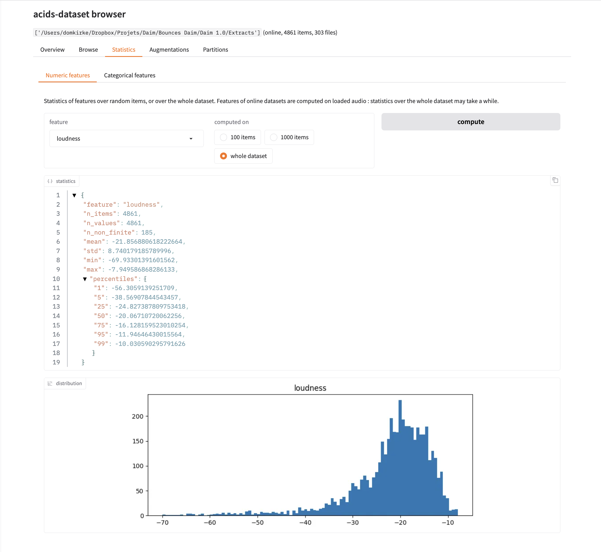

# acids-dataset

**Warning** `acids-dataset` is still experimental, do not hesitate to add issues! 

`acids-dataset` is a preprocessing package for audio data and metadata, mostly used by [RAVE](http://github.com/acids-ircam/RAVE) and [AFTER](http://github.com/acids-ircam/AFTER) but opened for custom use. Built on [lmdb](https://openldap.org/), it leverages the pre-processing step of data parsing required by audio generative models to extract metadata and audio features that can be accessed and used during training. It brings :

- Convenient pre-processing pipelines allowing to easily select / discard files, extract metadata with features of from filenames, and metadata hashing
- Data augmentations tailored for audio with probabilities
- Powerful data loaders for supervised / self-supervised learning with additional features (partitioning, multi-class indexing)
- An *online* mode, that loads raw audio folders directly (without pre-processing) with the same interface


## Documentation

The documentation (a step by step tutorial, the full user guide, and the API reference) is in `docs/`, built with [MkDocs](https://www.mkdocs.org) :

```bash
pip install -e ".[docs]"    # or pip install -r docs/requirements.txt
mkdocs serve                # local preview at http://127.0.0.1:8000
mkdocs build --strict       # static site in site/
```

It is published on GitHub Pages by `.github/workflows/docs.yml`, and can be hosted on Read the Docs with `.readthedocs.yaml`.

## Installation

To install acids-dataset, just install it through pip.

```bash
pip install acids-dataset
```

`acids-dataset` requires Python 3.10 or above. Its scientific dependencies are installed with pip, with minimum versions `numpy>=1.23.5`, `scipy>=1.8`, `scikit-learn>=1.0.2` and `librosa>=0.10.2` (tested in CI, see [Development](#development)).

**Some dependencies also have to be installed manually for some features.**

- `F0` and `Pitch` has `yin` and `pyin` methods installed  through `librosa`, but can also have `crepe`, `pesto`, `world`, or `praat` by installing libraries (respectively) [torchcrepe](https://github.com/maxrmorrison/torchcrepe), [pesto-pitch](https://github.com/SonyCSLParis/pesto), [pyworld](https://github.com/JeremyCCHsu/Python-Wrapper-for-World-Vocoder), or [praat-parselmouth](https://parselmouth.readthedocs.io/en/stable/index.html#).

The [dataset browser](#dataset-browser) requires [gradio](https://www.gradio.app), installed with `pip install acids-dataset[ui]`.

Audio loading in online mode relies on [soundfile](https://github.com/bastibe/python-soundfile) (installed with `acids-dataset`), that allows sample-accurate partial loading of `wav`, `flac`, `aiff`, `ogg`, `opus` and `mp3` files. Other formats (`m4a`, `aac`...) are loaded through [torchcodec](https://github.com/pytorch/torchcodec) (FFmpeg-based, installed with recent versions of `torchaudio`).

## Usage

`acids-dataset` is designed to easily:

- parse an audio dataset, automatically dealing with sampling rate, channels, metadata...
- computed before-hand and dynamically a wide variety of features (pitch, loudness, audio descriptors, custom classes...)
- custom class balancing, curriculum learning, partitioning, multi-dataset weighting
- handy data augmentation classes

There is two ways to use `acids-dataset` in your pipeline : either in *preprocessed* mode, where all the data is pre-processed in a compressed format with accompnying metadata, or in *online* mode, where the audio is minimally parsed in execution time and dynamically loaded in workers. Both modes share the same dataset interface, presented in [Datasets](#datasets) ; available features, augmentations and output formats are presented in [Features, augmentations and output format](#features-augmentations-and-output-format), and pre-processing in [Pre-processing](#pre-processing). Once you are familiar with both modes, [Presets](#presets) allow to share parsing settings between them.

# Datasets

`acids_dataset` brings adaptive and convenient data loading pipelines for audio compatible with `gin` and `torch.utils.Dataset`. 

## Loading a dataset

`AudioDataset` is the common interface of datasets : instantiating it with a path returns a `PreprocessedAudioDataset` if the path is a pre-processed dataset folder (see [Pre-processing](#pre-processing)), or an `OnlineAudioDataset` otherwise. Both share the same indexing, partitioning and loading interface.

```python
from acids_dataset.datasets import AudioDataset

dataset = AudioDataset("path/to/preprocessed")   # -> PreprocessedAudioDataset
dataset = AudioDataset("path/to/raw/audio")      # -> OnlineAudioDataset
dataset[0] # will provide automatically the "waveform" field as a single tensor
```

### Online mode

In online mode, audio files are parsed on the fly : there is no compilation step, and features are computed dynamically when data is loaded. Parsing parameters can be given directly, or with a [preset](#presets) (explicit arguments override the preset).

```python
from acids_dataset.datasets import AudioDataset
from acids_dataset.features import Loudness

dataset = AudioDataset(
  "path/to/your/dataset",            # or a list of folders
  sr = 44100,                        # target sampling rate (None to keep original ones)
  channels = 1,                      # target number of channels (None to keep original ones)
  chunk_length = 131072,             # in samples (int) or seconds (float)
  batch_by = "auto",                 # "files", "dataset" or "auto" (see Data loaders)
  pad_mode = "zero",                 # padding for chunks exceeding files ("zero", "repeat", "reflect", "replicate")
  features = [Loudness(), "mel"],    # computed dynamically ; objects or feature config names
  meta_regexp = ["**/{{instrument}}_*.wav"], # automatically create a "instrument" feature if audio file matches the regexp
  filters = [], 
  exclude = ["**/*.opus"]
)
loader = dataset.get_loader(batch_size=16, num_workers=4)
```

At initialization, audio files are scanned to retrieve their length, sampling rate, number of channels and codec, without decoding them ; path-based metadata (`meta_regexp`, see [Features](#features)) is also extracted. This information is cached in a `.ad` index file written in each dataset folder, such that next initializations only scan new or modified files (deleted files are removed from the index). Unreadable files are listed in `dataset.invalid_files` and are not scanned again until they are modified.

| Option        | Effect                                                                                     |
| ------------- | ------------------------------------------------------------------------------------------ |
| `index_dir`   | write index files as `<folder_name>.ad` in this folder (useful for read-only datasets)     |
| `rescan`      | ignore existing index files, and scan every file                                           |
| `write_index` | if `False`, do not write index files                                                       |

Several dataset folders can be given, as long as they have different names. Audio files are partially loaded (only the requested chunk is decoded), resampled to `sr`, and adapted to `channels`.

### Loading audio from files

Both modes give access to the audio files of the dataset, independently of dataset items : `dataset.files` lists the files (with their `audio_path`, `duration`, `sr` and `channels`), and audio or fragments can be loaded from a given file :

```python
wav = dataset.load_audio(file_idx, start=1.0, length=2.0)        # tensor (channels, samples), at the sampling rate of the dataset
fragment = dataset.get_fragment(file_idx, start=1.0, length=2.0)  # AcidsFragment, with waveform, metadata and features
fragment.get_array("loudness")
```

Features of fragments are computed on the loaded audio (the features of the dataset, or the ones given with `features=[...]`). For pre-processed datasets, audio is rebuilt from the chunks stored in the database : parts of files that were not stored (e.g. discarded chunks) are filled with zeros, and datasets pre-processed without waveform cannot load audio.

### Baked features

Features of online datasets are computed every time a chunk is loaded. Heavy features (e.g. spectrograms, pitch, neural embeddings) can be *baked* : computed once on whole audio files, and stored in `.ad` files that chunks read instead of computing features.

```python
dataset = AudioDataset("path/to/raw/audio", sr=44100, chunk_length=131072, features=[Mel(), F0(mode="pyin"), Loudness()])
dataset.bake_features("mel_128", "f0")                  # every feature if no name is given ; path=... for another destination

# later, in another script : baked features replace the features of the same name
dataset = AudioDataset("path/to/raw/audio", sr=44100, chunk_length=131072, features=[Mel(), F0(mode="pyin"), Loudness()])
dataset.use_baked_features("mel_128", "f0")             # check=True : every file must have an up-to-date baked file
loader = dataset.get_loader(batch_size=16, num_workers=4)
```

- Baked files mirror the architecture of dataset folders : `<dataset folder>/ad-features/<relative audio path>.ad` by default, or `<path>/<dataset folder name>/<relative audio path>.ad` with `path`. Each file contains the features of the whole audio file (time last), and its metadata : original sampling rate of the file, sampling rate and channels features were computed with, frame rate (`feature_sr`) and frame offset of each feature, configuration of features, and size / modification date of the audio file. Files are written in numpy's `.npz` format (`acids_dataset.datasets.baked.read_baked_file` reads them).
- Baking is incremental : features already baked with the same configuration, for unchanged audio files, are skipped (unless `overwrite=True`), and new features are added to existing files. Partitions bake their files only.
- `use_baked_features(*names, path=None, check=True)` reads given features from baked files (every feature baked for the first file if no name is given). Dataset features of the same names are replaced, and other names are added to the features of the dataset : baked features do not need to be given to the dataset. With `check=True`, every file is checked (existing baked file, unchanged audio file, same sampling rate and channels, same configuration as the dataset feature of the same name) ; with `check=False`, missing baked files raise errors when loading. `dataset.baked_features` lists baked features.
- Chunks get the frames of their position in the features of the whole file : from the frame closest to their start, as many frames as the feature gives on a chunk. Values may thus differ from features computed on chunks by the alignment of frames (up to half a hop), and at the edges of chunks (features of chunks are computed on padded chunks, baked features on whole files).
- Only features with a time axis (last) can be baked : per-chunk descriptors (e.g. `Tempo`, `AttackTime`) and non-array features (`AfterMIDI`, metadata) cannot.

### From online to pre-processed datasets

Once settled, an online dataset can be compiled into a pre-processed dataset with the same files (filters, exclusions, without the unreadable files of the index), parsing settings (sampling rate, channels, chunk length, padding mode, `loudness_threshold`), `meta_regexp` and features :

```python
dataset = AudioDataset("path/to/raw/audio", preset="rave", meta_regexp=[...], features=[Loudness()], exclude=["**/drafts/*"])
dataset.split({"train": 0.8, "valid": 0.2}, features=["original_path"], seed=0, write="split")
preprocessed = dataset.preprocess("path/to/compiled", exclude_flags=["silent", "clipping"])   # a PreprocessedAudioDataset
partitions = preprocessed.load_partition("split")                                           # same files as online partitions
```

- `hop_length` sets the hop between pre-processed chunks (half of `chunk_length` by default), `features` other features, `waveform=False` stores features only, and `preset` / `override` other parsing parameters. The size of the database is estimated from the durations of the index.
- Written partitions are carried to the pre-processed dataset (`partitions=True`, a list of names, or `None`), matching files by audio paths : validation files stay the same in both modes.
- `exclude_flags` excludes files flagged by the [health report](#dataset-health) (computed on every file, with `health_thresholds`).
- The source of the dataset (folders, index, filters, `meta_regexp`, excluded and unreadable files) is recorded in the `source` entry of its metadata. Partitions of online datasets can be compiled too (only their files are parsed).

## Metadata

Dataset metadata is accessible through `dataset.metadata` (for pre-processed datasets, see also [Get information](#get-information)). In online mode, the list of scanned files with their header information and path-based metadata is available through `dataset.files`.

`acids_dataset` also provides handy methods to retrive data from a given label :
```python
note_a_data = dataset.query_from_features(..., pitch='A') # retrieve all the data with 0 pitch class
note_a_data = dataset.query_from_features(10, pitch='A') # retrieve 10 exemples with 0 pitch class
note_a_data = dataset.query_from_features(10, pitch='A', original_path=['file1.wav', 'file2.wav']) # retrieve 10 exemples with 0 pitch class in given data files
```

Features available for querying are hashed in `dataset.feature_hash` (`{feature: {value: indices}}`). In online mode, only path-based features (`original_path` and `meta_regexp` features) can be used for search and partitioning, as they are known without loading audio. `index_for_features` then returns file indices, and `query_from_features` returns chunks of the matching files.

## Data loaders

`get_loader` (available in both modes) returns a `torch.utils.data.DataLoader` with a random sampler (or a sequential one with `shuffle=False`). Arguments of `DataLoader` (`num_workers`, `drop_last`...) are given to the loader, other ones (`chunk_length`, `batch_by`, `pad_mode` in online mode) configure the dataset.

```python
loader = dataset.get_loader(batch_size=16, num_workers=4, drop_last=True)
loader = dataset.get_loader(batch_size=16, max_samples=10000, replacement=True) # fixed number of samples per epoch
```

The chunk length of pre-processed datasets is fixed at compilation : giving a different `chunk_length` to `get_loader` raises an error.

### Chunking strategy (online mode)

In online mode, dataset items are chunks of `chunk_length` samples, that can be given at initialization, or later with `configure` or `get_loader` (that return configured copies of the dataset). The way chunks are distributed in the dataset is set by `batch_by` :

| `batch_by`  | Items                                                                                                                                                                                                                                  |
| ----------- | -------------------------------------------------------------------------------------------------------------------------------------------------------------------------------------------------------------------------------------- |
| `"files"`   | one item per file, taken at a random position of the file. Files shorter than `chunk_length` are padded with `pad_mode`. Each file has the same weight, whatever its duration.                                                         |
| `"dataset"` | each file is split in `round(duration / chunk_length)` slots (at least 1), and each item is taken at a random position in its slot. The dataset length is then about `total_duration / chunk_length`, and chunks never overlap two files. |
| `"auto"`    | `"dataset"` if the median file duration is longer than `auto_ratio * chunk_length` (a few long files, default `auto_ratio=2`), `"files"` otherwise (a lot of short files).                                                              |

As items are taken at random positions, the same index gives different chunks across epochs (random positions are seeded independently in each `DataLoader` worker). `dataset.chunk_position(index, random_offset=False)` gives the deterministic (file, start) position of an item.

```python
dataset = AudioDataset("path/to/your/dataset", sr=44100)
train_loader = dataset.get_loader(batch_size=16, chunk_length=1., batch_by="dataset", num_workers=4)
len(train_loader.dataset)                    # ~ total duration / 1 second
dataset.configure(chunk_length=2.).batch_by  # "auto" is resolved once chunk_length is known
```

If files have different sampling rates, `sr` must be given so that all the items of a batch have the same size.

With `loudness_threshold` (in LUFS, e.g. `-60`), chunks quieter than the threshold (e.g. silence) are drawn again at a random position of their file, up to `max_retries` times (10 by default) ; files that are silent everywhere still give silent chunks. This is the online counterpart of the `loudness_threshold` of pre-processing (the `after` preset sets both).

Without `chunk_length`, items are whole files (loaded at `sr`, or at their own sampling rate if `sr` is not given). As files have different lengths, they cannot be batched : `get_loader` then requires `batch_size=1` (or a `collate_fn`).

## Partitioning

Datasets can be split into partitions, randomly or according to features (such that each feature value belongs to a single partition) :

```python
partitions = dataset.split({"train": 0.8, "valid": 0.2})                                   # random split
partitions = dataset.split({"train": 0.8, "valid": 0.2}, features=["original_path"])       # chunks of a file stay in the same partition
partitions = dataset.split({"train": 0.8, "valid": 0.2}, features=["instrument"], 
                           balance_cardinality=True, tolerance=0.1)                         # balance partition sizes
partitions = dataset.split({"train": 0.8, "valid": 0.2}, features=["loudness"], n_bins=10) # stratified over a continuous feature
partitions = dataset.split({"train": 0.8, "valid": 0.2}, seed=0)                          # reproducible split
partitions = dataset.split({"train": 0.8, "valid": 0.2}, write="my_split")                 # write partition
partitions = dataset.load_partition("my_split")                                             # load it back
train_loader = partitions["train"].get_loader(batch_size=16)
```

- Partitions are drawn with the global random state, unless `seed` is given : partitions with the same seed are identical, including the order of their items. **For distributed training, give the same seed in every process** (otherwise each process gets different partitions, mixing training and validation data), or split and write partitions in one process and load them in the others.
- Continuous features (e.g. `loudness`, or any feature that is not hashed) give stratified partitions : items (or files in online mode, or groups of categorical features, e.g. `features=["original_path", "loudness"]`) are sorted in `n_bins` quantile bins of the mean value of the feature (histogram), and distributed among partitions such that each partition has a similar distribution of the feature. At most one continuous feature can be given. In online mode, feature values are computed on the items of each file, which may take a while.
- With `balance_cardinality=True`, feature values are distributed such that partition sizes follow the given ratios (with a warning if a partition exceeds `tolerance`). If ratios sum to 1, every item belongs to a partition ; otherwise, the remaining part is left out.
- If a `partition` feature exists (e.g. `--meta_regexp "**/{{partition}}/*.wav"` for `train/` and `valid/` subfolders), its values are used as partitions (disable with `use_meta_if_available=False`).
- Pre-processed datasets write partitions in `<dataset>/partitions/`. Online datasets partition files (chunks of a file always belong to the same partition), and write partitions as json files referring to audio paths in `.ad_partitions/` of the first dataset folder (or in the `partitions` subfolder of `index_dir`, or in `partition_dir` if given) ; partitions are robust to added / removed files.

## Multi-dataset

Several datasets (pre-processed or online) can be combined with `CombinedAudioDataset`, that is an `AudioDataset` : items, slices, `files`, `load_audio`, `get_fragment`, `get_loader`, partitions and `to` work as for other datasets. Combined datasets must share the same output pattern. Datasets can be given as objects or as paths ; a list of paths that contains a pre-processed dataset given to `AudioDataset` also returns a combined dataset (a list of raw folders gives a single online dataset).

```python
from acids_dataset.datasets import AudioDataset, CombinedAudioDataset

dataset = CombinedAudioDataset([AudioDataset("path/to/dataset1"), AudioDataset("path/to/dataset2")], weights=[0.7, 0.3])
dataset = AudioDataset(["path/to/preprocessed", "path/to/raw/audio"], sr=44100)    # dataset arguments are given to each dataset
loader = dataset.get_loader(batch_size=16, chunk_length=131072)                     # loading arguments configure online datasets
```

`weights` are the sampling probabilities of datasets (here, 70% of items come from the first dataset, whatever the sizes of datasets) ; without weights, items are sampled uniformly. Loading arguments (`chunk_length`, `batch_by`, `features_after_transforms`...) configure the datasets they apply to ; a `chunk_length` different from the one of a pre-processed dataset raises an error, as items could not be batched together.

Combined datasets can be partitioned with `split` and `load_partition` (each dataset is split with the same arguments, and partitions are combined datasets of the partitions of each dataset). You can also parse several data folders into a single pre-processed dataset (see [Simple parsing](#simple-parsing)), or give several folders to an online dataset.

## Balanced sampling and curriculum

### Class balancing

`get_loader` / `get_sampler` can balance the labels of features : values of categorical features (`meta_regexp` features, `original_path`, hashed features), or histogram (quantile) bins of continuous features (e.g. `loudness`, with `n_bins`).

```python
loader = dataset.get_loader(batch_size=32, balance_by="instrument")                         # each instrument equally likely
loader = dataset.get_loader(batch_size=32, balance_by=["instrument", "pitch"], balance_power=0.5)
loader = dataset.get_loader(batch_size=32, balance_by="loudness", sampler_kwargs={"n_bins": 10})  # flat loudness distribution
loader = dataset.get_loader(balance_by="instrument", balanced_batches=(8, 4))                 # 8 instruments x 4 items per batch
```

- Item weights are `count(label) ** -balance_power` : `balance_power=1` samples labels uniformly, `0` samples items uniformly (no balancing), and values in between soften the imbalance. Items without label are excluded (or form their own class with `sampler_kwargs={"missing": "class"}`).
- In online mode, labels of path-based features are given by files, and continuous features are averaged over the items of each file. `dataset.item_labels(features)` gives the label of each item.
- In combined datasets, labels are balanced within each dataset, and datasets are sampled with their `weights`.
- `balanced_batches=(classes_per_batch, items_per_class)` gives batches of distinct labels, e.g. for contrastive learning.

Samplers are reproducible with `seed`, and distributed : each process gets its share of items, from `rank` / `world_size` (`sampler_kwargs`), or from `torch.distributed` if initialized. Samplers are `DistributedSampler` subclasses : Lightning does not wrap them, and calls their `set_epoch` at each epoch (with `balanced_batches` in distributed training, use `Trainer(use_distributed_sampler=False)`).

### Curriculum

A `Curriculum` schedules sampled items from their difficulty : items whose difficulty rank is below a competence `c(t)` are sampled, `c(t)` growing from `start` to `end` along `length` epochs or steps (`unit`), with a `"linear"`, `"sqrt"` or `"exp"` schedule. With `mode="soft"`, weights decrease smoothly above the competence. Curricula combine with class balancing (weights are multiplied).

```python
from acids_dataset.sampling import Curriculum, rarity

curriculum = Curriculum(rarity(dataset.item_labels("instrument")), start=0.3, end=1., length=20, unit="epoch")
loader = dataset.get_loader(batch_size=32, curriculum=curriculum, seed=0)
for epoch in range(n_epochs):
    loader.sampler.set_epoch(epoch)       # done by Lightning
    ...
```

Difficulties can be :
- the **rarity** of labels (`rarity(labels)` : `-log(frequency)`), such that common labels come first ;
- **custom difficulties** given by the user : an array with a difficulty for each item (e.g. from an external model, annotations, or precomputed descriptors), or a callable `difficulty(epoch, step)` returning such an array, e.g. :

```python
import numpy as np
difficulty = np.array([my_difficulty(dataset.get_fragment(...)) for ...])   # one value per item (see dataset.files / item_labels)
curriculum = Curriculum(difficulty, start=0.2, length=10)
curriculum = Curriculum(lambda epoch, step: scores_at(epoch), start=0.2, length=10)
```

Items with unknown difficulties (NaN) are ranked in the middle.
- **training losses**, recorded by a `LossTracker` (see below).

With `unit="step"`, items are drawn by blocks (`block_size`, 1024 by default) with the competence at the current step, given by `curriculum.step(step)` (done by the Lightning callback).

### Loss feedback

A `LossTracker` records the losses of items during training, and gives their difficulty to a curriculum (self-paced learning : items with low losses first). Losses are recorded per item with a strategy (`"ema"` exponential moving average with `momentum`, `"mean"`, `"last"`, or `"max"`) ; with `groups` (e.g. `dataset.item_labels("original_path")`), items that were never seen get the mean loss of their group (e.g. their file), and `tracker.statistics()` gives the distribution of losses among items and groups. Item indices are given by an `index` entry in the output pattern.

```python
import pytorch_lightning as pl
from acids_dataset.sampling import Curriculum, LossTracker
from acids_dataset.lightning import CurriculumCallback

dataset.output_pattern = "{waveform,index}"
tracker = LossTracker(len(dataset), strategy="ema", groups=dataset.item_labels("original_path"))
curriculum = Curriculum(tracker, start=0.3, length=20)
loader = dataset.get_loader(batch_size=32, curriculum=curriculum, seed=0)

class Model(pl.LightningModule):
    def training_step(self, batch, batch_idx):
        losses = self.item_losses(batch["waveform"])          # one loss per item
        return {"loss": losses.mean(), "item_losses": losses.detach()}

trainer = pl.Trainer(callbacks=[CurriculumCallback(curriculum, tracker)])
trainer.fit(Model(), loader)
```

`CurriculumCallback` sets the steps of step-based curricula, records item losses (gathered over processes in distributed training), logs the competence and the mean recorded loss, and saves curricula and trackers in checkpoints (several callbacks need different `name`s). Without Lightning, call `tracker.update(batch["index"], losses)` and `curriculum.step()` / `sampler.set_epoch(epoch)` in the training loop.

## Dataset browser

<center></center>

`acids-dataset` provides a simple web interface to explore pre-processed datasets and raw audio folders, launched with :

```bash
acids-dataset ui --path /path/to/dataset                                      # pre-processed dataset
acids-dataset ui --path /path/to/raw/audio --feature loudness --chunk_length 1. --meta_regexp "**/{{instrument}}_*.wav"
```

or in Python with `acids_dataset.ui.launch("path/to/dataset", **dataset_kwargs)`. It opens in the browser, with the following tabs :

| Tab           | Content                                                                                                                                  |
| ------------- | ---------------------------------------------------------------------------------------------------------------------------------------- |
| Overview      | dataset summary (items, files, durations, sampling rates, features, partitions), list of files, and health report                         |
| Browse        | listen to dataset items (with their waveform, spectrogram, features and metadata), or to a part of a file                                 |
| Statistics    | statistics and histograms of features over random items or over the whole dataset (computed on loaded audio for online datasets), and number of items per value of categorical features |
| Augmentations | applies transforms (from `acids_dataset/configs/transforms`) to an item, to listen to and compare original and augmented audio            |
| Partitions    | creates partitions (random, or grouped by features, balanced, seeded ; previewed before being written), and shows sizes, distribution of categorical features, and files shared between partitions |

For raw audio folders, the options of online datasets are available (`--preset`, `--sample_rate`, `--chunk_length` (one second by default), `--batch_by`, `--feature`, `--meta_regexp`, `--filter`, `--exclude`, `--write_index`) ; see `acids-dataset ui --help`. The browser can also be built from an existing dataset with `acids_dataset.ui.DatasetBrowser(dataset)` and `acids_dataset.ui.build_app`.

# Features, augmentations and output format

## Output format

Outputs of datasets are set by an output pattern, that allows to index / transform complex datasets, and provide easy way to perform multi-view indexing in a very simple way.

```python
import torch
from acids_dataset import transforms as adt
from acids_dataset.datasets import AudioDataset

data_path = "..."
one_hot = lambda p: torch.nn.functional.one_hot(p.long() % 12, 12) # transforms can be any callable
dataset = AudioDataset(data_path)
dataset[0] # will provide automatically the "waveform" field as a single tensor
dataset.get(0) # __getitem__ is a proxy for .get function, that's actually much more powerful
dataset.get(0, "(waveform,mel)") # => returns both waveform and mel fields as a tuple
dataset.get(0, "{waveform,mel}") # => returns both waveform and mel fields as a dictionary with waveform and mel keys
dataset.get(0, "{waveform,mel->z}") # => same, but put mel vector in field "z"
dataset.get(0, "{waveform[0]->x_l, waveform[1]->x_r}") # => puts first channel in x_l field, second in x_r field
dataset.get(0, "(waveform,pitch)", [adt.Gain(), one_hot]) # => you can add also transforms (one per output, see below)
dataset.get(0, "{waveform,pitch}", {'pitch': one_hot}) # => same with dict outputs, only for given keys

# you can also specify during initialisation
dataset = AudioDataset(data_path, output_pattern="{waveform->x,pitch->y}", transforms={"y": one_hot})
out = dataset[0] 
```

Datasets can also be indexed with slices or sequences of indices, that return batches of items (collated as with a `torch.utils.data.DataLoader`, or as a list if items have different shapes) :

```python
dataset[0:4]                                    # => tensor of shape (4, channels, chunk_length)
dataset[-2:]                                    # => last two items
dataset[[0, 5, 7]]                              # => lists, tuples, numpy arrays or tensors of indices
dataset.get(slice(0, 4), "{waveform,mel}")      # => dictionary of batched waveform and mel
```

Output patterns access the buffers of data fragments (waveform and array features). Path-based metadata extracted with `meta_regexp` is stored as fragment metadata, and is not accessible through output patterns.

## Features

Features (like audio descriptors) can be embedded in pre-processed datasets to make them accessible during training (see [Embedding features](#embedding-features)), or computed dynamically in online mode by giving them to the dataset (`features=[...]`). Features can also be defined in [presets](#presets), to be used in both modes. Feature configurations are contained in `acids_dataset/configs/features`, and can be customized (see [Customizing features](#customizing-features)).

Among all the available features, the `RegexpFeature` is a special feature that extracts metadata from file paths. By providing `meta_regexp` patterns, that can be understood as glob patterns with placeholders contained withing double curvy braces. For example, let's imagine (like Slakh) that your dataset is organised as folows :

```text
dataset/
  Track00001/
    mix.flac
    stems/
      S01.flac
      S02.flac
      ...
  Track00002/
    mix.flac
    stems/
      S01.flac
      S02.flac
```

you can extract respectively the track ids and the instrument ids into `id` and `inst` features with the pattern `"Track{{id}}/stems/S{{inst}}.flac"` (see [Embedding features](#embedding-features) for the command line, or give `meta_regexp=[...]` to an online dataset).

### Audio descriptors

Each descriptor is a feature (computed in pre-processing or online, and in [batches](#batch-features) on GPU). They are computed on the mix of channels, or on each channel with `keep_channels=True` (that adds a channel axis). Per-frame descriptors use `frame_length` / `hop_length` (non-overlapping frames by default) and give `(..., n_frames)` ; frequency descriptors are given in Hz, or normalized (ratio of the Nyquist frequency) or in midi with `unit`. Silent frames give 0.

| Family | Feature | Output | Description |
| ------ | ------- | ------ | ----------- |
| spectral | `SpectralCentroid` | per frame, `unit` | center of mass of the spectrum (brightness) |
| | `SpectralSpread` | per frame, Hz / normalized | bandwidth around the centroid |
| | `SpectralSkewness`, `SpectralKurtosis` | per frame | asymmetry and peakedness of the spectrum |
| | `SpectralRolloff` | per frame, `unit` | frequency below which `percentile` (0.85) of the energy lies |
| | `SpectralFlatness` | per frame, [0, 1] (or dB) | geometric / arithmetic mean of the spectrum (~0 for tones, ~0.56 for white noise) |
| | `SpectralCrest` | per frame | max / mean of the spectrum |
| | `SpectralFlux` | per frame | spectral change between consecutive frames |
| | `SpectralContrast` | `(n_bands, n_frames)`, dB | peak / valley difference in octave bands |
| representations | `STFT` | `(K, n_frames)` | short-time Fourier transform : complex, magnitude, power, dB, phase, real / imaginary parts, power density, instantaneous phase or frequency, see [Spectral representations and LPC](#spectral-representations-and-lpc) |
| | `DGT` | `(K, n_frames)` | discrete Gabor transform (STFT with gaussian windows, phase reconstruction with PGHI) |
| | `FFT` | `(K,)` | Fourier transform of the whole chunk (same modes, one-sided or full spectrum) |
| | `PQMF` | `(C * n_bands, T / n_bands)` | pseudo-QMF filter bank : critically sampled sub-bands (and their synthesis) |
| | `DCT` | `(n_coeffs, n_frames)` | discrete cosine transform of frames |
| | `Gammatone` | `(n_bands, n_frames)`, power or dB | energy in gammatone filters equally spaced on the ERB scale |
| | `Cepstrum` | `(n_coeffs, n_frames)` | real cepstrum : inverse Fourier transform of the log magnitude spectrum |
| | `LPC` | `(order, n_frames)` | linear prediction coefficients, reflection coefficients, line spectral frequencies or spectral envelope |
| temporal | `RMS` | per frame, dB (or linear) | root mean square energy |
| | `ZeroCrossingRate` | per frame, ratio or Hz | sign changes (in Hz : frequency of a sine with the same rate) |
| | `AttackTime` | per chunk, seconds | rise time of the envelope from 10% to 90% of its maximum |
| | `TemporalCentroid` | per chunk, seconds | center of mass of the envelope |
| | `CrestFactor` | per chunk, dB (or linear) | peak / RMS ratio |
| onsets | `OnsetStrength` | per frame | rectified flux of log-magnitude spectra |
| | `OnsetRate` | per chunk, onsets / s | peaks of onset strength (the first frame of a chunk cannot be an onset) |
| | `Tempo` | per chunk, BPM | autocorrelation of onset strength, with a prior around `prior_bpm` (120) |
| harmonic | `Chroma` | `(12, n_frames)` | energy of pitch classes (0 : C ... 11 : B) |
| | `Harmonicity` | per frame, [0, 1] | periodicity (normalized autocorrelation) |
| | `Inharmonicity` | per frame | mean relative deviation of partials from a harmonic series |
| spatial | `MidSide` | `(2, T)` | mid / side transform of stereo signals (and its inverse) |
| | `Width`, `SpatialCovariance`, `CrossSpectralMatrix`, `SpectroSpatialCovarianceVector` | see [Spatial features](#spatial-features) | stereo width, inter-channel covariances, cross spectral matrices, SSCV |
| | `InterChannelLevelDifference` | `(C - 1, n_frames)`, dB | level of each channel relative to the first one (per band with `n_bands`) |
| | `InterChannelTimeDifference` | `(C - 1, n_frames)`, samples or seconds | delay of each channel relative to the first one |
| | `InterChannelCoherence` | `(C - 1, n_frames)`, [0, 1] | maximum cross-correlation with the first channel |
| | `GeneralizedCrossCorrelation` | `(P, n_frames)`, samples or seconds (or `(P, n_lags, n_frames)`) | GCC-PHAT (and other weightings) delays between pairs of channels |
| | `Pan` | per frame, [-1, 1] | stereo position from the energies of the first two channels |
| | `AmbisonicEncoder`, `AmbisonicDecoder` | `((N + 1)², T)`, `(L, T)` | ambisonic encoding and decoding, see [Ambisonics](#ambisonics) |
| quality | `ClippingRatio` | per chunk | ratio of clipped samples |
| | `DCOffset` | per chunk (per channel) | mean value |
| | `DynamicRange` | per chunk, dB | difference between high and low percentiles of frame levels |
| | `SilenceRatio` | per chunk | ratio of silent frames |

```python
from acids_dataset.features import SpectralCentroid, Tempo, Chroma
dataset = AudioDataset("path/to/raw/audio", chunk_length=4., features=[SpectralCentroid(unit="normalized"), Tempo(), Chroma()])
```

Per-chunk descriptors can be used for [balancing](#class-balancing) and [stratified partitions](#partitioning), as other continuous features.

### Loudness

`Loudness` gives the loudness in LUFS (per frame with `frame_length`, per channel with `keep_channels`). Values are floored to `min_loudness` (-70 LUFS by default, the absolute gate of loudness measurements), such that silence gives -70 instead of `-inf` (that would give NaN in losses) ; `min_loudness=None` keeps `-inf`.

### Spatial features

`MidSide` is the mid / side transform of stereo signals : `(..., 2, T)` gives `(..., 2, T)`, mid first, with M = (L + R) / 2 and S = (L - R) / 2 (`normalization="average"`, default), or M = (L + R) / √2 and S = (L - R) / √2 (`normalization="orthonormal"`, energy preserving). `inverse=True` decodes mid / side signals into left / right signals (feature name : `leftright`), and `invert` gives inputs back. Inputs that do not have 2 channels raise a `ValueError`.

`Width`, `SpatialCovariance`, `CrossSpectralMatrix`, `SpectroSpatialCovarianceVector` and `GeneralizedCrossCorrelation` describe multichannel audio, per frame (`frame_length`, `hop_length`) :
- `Width` measures the stereo width from a mid / side analysis (mid = mean of channels, side = residual of each channel, i.e. (L + R) / 2 and ±(L - R) / 2 in stereo, generalized to any number of channels). `mode="width"` (default) gives side / (mid + side) energy in [0, 1] (0 for identical channels, 0.5 for uncorrelated channels, 1 for opposite channels), `mode="ratio"` the side to mid ratio in dB, and `mode="energy"` both energies in dB.
- `SpatialCovariance` gives the covariance matrices between channels, `(C, C, n_frames)`, normalized as correlations by default (`normalize=True`). With `n_bands`, matrices are computed on the spectrum and summed over `n_bands` linear frequency bands, with real and imaginary parts stacked : `(2, n_bands, C, C, n_frames)` (coherence matrices if normalized).
- `CrossSpectralMatrix` gives the cross spectral matrices (CSM) used in beamforming and acoustic imaging, per frequency bin : each frame (`frame_length`, 4096 by default) is estimated with Welch's method, averaging `X_i conj(X_j)` over hann-windowed segments of `n_fft` samples (1024) with 50% overlap, with a power spectral density scaling (`C[i, j]` equals `scipy.signal.csd(x_j, x_i)` on the frame). `mode="complex"` (default) stacks real and imaginary parts, `(2, K, C, C, n_frames)` ; `"magnitude"`, `"phase"` and `"coherence"` (magnitude squared coherence, in [0, 1]) give `(K, C, C, n_frames)`. Bins can be restricted with `fmin` / `fmax` (Hz) and averaged in `n_bands` linear bands, and their center frequencies are given by the `frequencies` attribute. Full-resolution matrices are large (`n_fft // 2 + 1` bins for each pair of channels) : restrict or band them before storing them in a pre-processed dataset.

```python
from acids_dataset.features import CrossSpectralMatrix
csm = CrossSpectralMatrix(n_fft=1024, fmin=100, fmax=8000, n_bands=32, mode="coherence", sr=44100)
dataset = AudioDataset("path/to/multichannel/audio", chunk_length=2., features=[csm])
```
- `SpectroSpatialCovarianceVector` is the Spectro-Spatial Covariance Vector (SSCV) of [Meng et al.](https://arxiv.org/abs/2411.03172), designed for first-order ambisonics recordings (and applicable to any number of channels `M`). Covariance matrices are computed in `n_bands` mel bands (52), on hann-windowed frames of 96 ms with 50% overlap by default, and optionally smoothed over frames with a one-pole filter (`alpha`, 0 by default : the paper learns it jointly with the model). Each matrix is turned into `M^2` real values : a real DFT of its diagonal, and the real and imaginary parts of its off-diagonal entries, normalized by the energy of the band, whose log is given first. Output : `(M^2, n_bands, n_frames)`, i.e. `(16, 52, n_frames)` for FOA. All values but the first one are invariant to the gain of the signal.

```python
from acids_dataset.features import SpectroSpatialCovarianceVector
dataset = AudioDataset("path/to/foa/recordings", sr=16000, chunk_length=4., features=[SpectroSpatialCovarianceVector(sr=16000)])
```

`GeneralizedCrossCorrelation` gives the generalized cross-correlation (GCC, [Knapp & Carter, 1976](https://doi.org/10.1109/TASSP.1976.1162830)) between pairs of channels, for time delay estimation and sound source localization. Its cross-spectrum is weighted with `weighting` : `"phat"` (phase transform, default ; `beta < 1` gives PHAT-β), `"scot"`, `"roth"`, `"ht"` (Hannan-Thomson / maximum likelihood) or `"none"` (normalized cross-correlation). Spectra are averaged over segments of `n_fft` samples in each frame (`n_fft = frame_length` by default) : `"scot"`, `"roth"` and `"ht"` differ from `"phat"` only with several segments per frame (`frame_length >> n_fft`). Pairs are each channel with the first one (`pairs="reference"`, `P = C - 1`) or all pairs `i < j` (`pairs="all"`, `P = C (C - 1) / 2`). `mode="delay"` (default) gives the lag of the GCC peak within `±max_delay` (1 ms by default, `None` for all lags), with sub-sample resolution (parabolic interpolation, and upsampling with `interp`), in samples or seconds (`unit`) : `(P, n_frames)`. `mode="correlation"` gives the GCC itself, `(P, n_lags, n_frames)`, with lags in the `lags` attribute. Positive delays : the second channel of the pair is delayed.

```python
from acids_dataset.features import GeneralizedCrossCorrelation
gcc = GeneralizedCrossCorrelation(frame_length=4096, n_fft=1024, weighting="phat", max_delay=5e-4, interp=4, pairs="all", unit="seconds", sr=48000)
dataset = AudioDataset("path/to/microphone/array", sr=48000, chunk_length=2., features=[gcc])
```

### Spectral representations and LPC

`STFT`, `DGT`, `DCT`, `Gammatone`, `Cepstrum` and `LPC` are computed on windowed frames (`frame_length`, `hop_length`, `window` : `"hann"` by default, `"hamming"` or `None`). Like other descriptors, they describe the mix of channels, or each channel with `keep_channels=True`, and give `(..., n, n_frames)`.

- `STFT` gives the short-time Fourier transform of frames of `frame_length` samples, zero-padded to `n_fft` (`frame_length` by default), every `hop_length` samples (`frame_length // 4` by default) ; `center=True` pads signals with `frame_length // 2` zeros on both sides. Its `mode` is one mode or a list of modes :
    - `"complex"`, `"magnitude"` (default), `"power"`, `"db"` (10 log10 of the power), `"phase"`, `"real"`, `"imaginary"` ;
    - `"power_density"` : power spectral density in V²/Hz, as `scipy.signal.spectrogram(scaling="density")` ;
    - `"instantaneous_phase"` : phase difference between consecutive frames, wrapped in [-π, π] (time derivative of the unwrapped phase, as the instantaneous frequency of GANSynth up to a factor π) ;
    - `"instantaneous_frequency"` : frequency (Hz) of each bin, from the phase difference between frames (phase vocoder) : a stationary sinusoid gives its exact frequency around its peak.

  Several modes are stacked on the channel axis, modes first : `(..., n_modes * C, K, n_frames)`, or `(..., n_modes, K, n_frames)` for the mix of channels. Outputs are real, unless `"complex"` is given (other modes are then cast to complex values). Frequencies of bins are given by the `frequencies` attribute.

  `STFT` is computed with [acids_transforms](https://github.com/acids-ircam/acids_transforms), and can be inverted, scripted and streamed for real-time use :
    - `feature.invert(features, inversion_mode=None, length=None)` gives back audio (`(..., T)` for the mix of channels, `(..., C, T)` with `keep_channels`, cropped or zero-padded to `length`) : exactly from `"complex"`, (`"real"`, `"imaginary"`) or a magnitude (`"magnitude"`, `"power"`, `"db"`, `"power_density"`) with `"phase"` ; approximately with instantaneous phases or frequencies ; and from magnitudes only with `inversion_mode` (`"griffin_lim"` by default, `"random"`, `"keep_input"` or `"sinebank"`).
    - `feature.script()` gives a module for `torch.jit.script`, with `forward` (the feature) and `invert`.
    - `feature.streaming()` gives a scriptable module computing the feature on chunks of audio `(..., C, T)` (`T` a multiple of `hop_length`) : each chunk gives its `T // hop_length` frames, that are the ones of the feature with `center=False` (after `frame_length // hop_length - 1` frames containing the initial zeros of the stream). `invert` gives back chunks of audio, delayed by `latency = frame_length - hop_length` samples ; call `reset()` between streams.

  ```python
  stft = STFT(frame_length=1024, hop_length=256, mode=["magnitude", "phase"], sr=44100)
  audio = stft.invert(stft(x))                                  # exact reconstruction
  stream = torch.jit.script(stft.streaming())
  for chunk in chunks:                                          # chunks of n * 256 samples
      frames = stream(chunk)                                    # (2, 513, n)
      out = stream.invert(frames)                               # chunk of audio, delayed by stream.latency samples
  ```
- `DGT` gives the discrete Gabor transform of [acids_transforms](https://github.com/acids-ircam/acids_transforms) : an STFT with a gaussian window of `n_fft` samples (1024), every `hop_length` samples (`n_fft // 4` by default), on frames centered on `t * hop_length` (signals are padded by reflection), with the modes `"complex"`, `"magnitude"` (default), `"power"`, `"db"`, `"phase"`, `"real"` and `"imaginary"`, stacked as in `STFT`. Gaussian windows suit phase reconstruction from magnitudes : `invert` uses PGHI (phase gradient heuristic integration) by default (see [Inverting features](#inverting-features)).
- `FFT` gives the Fourier transform of the whole chunk (optionally windowed, and cropped or zero-padded to `n_fft`), with the modes of `STFT` but instantaneous ones : `(..., K)`, with `K = n_fft // 2 + 1` (or the full spectrum of `n_fft` frequencies with `onesided=False`). `"power_density"` is the periodogram of the chunk (`scipy.signal.periodogram(scaling="density")`), and frequencies are given by `frequencies(n_samples)`. `invert` gives the chunk back from modes with phase.
- `PQMF` is a pseudo-QMF filter bank (as in multi-band vocoders and RAVE) : it splits `(..., C, T)` into `n_bands` (16) critically sampled sub-bands, `(..., C * n_bands, T / n_bands)` (bands of the first channel first ; signals are zero-padded to a multiple of `n_bands`), and `inverse=True` recombines sub-bands into signals. Filters are cosine modulations of a kaiser-windowed prototype (`attenuation`, 100 dB), optimized to cancel aliasing between bands : analysis followed by synthesis reconstructs signals with an error of about -60 dB, without delay (`invert` gives signals back from sub-bands).
- `DCT` gives the discrete cosine transform (type II, orthonormal) of each frame : the `n_coeffs` first coefficients of `scipy.fft.dct(frame, norm="ortho")` (all of them by default). `invert` gives audio back by inverse DCT and overlap-add (see [Inverting features](#inverting-features)).
- `Gammatone` gives the energy of frames in `n_bands` (64) gammatone filters, with center frequencies equally spaced on the ERB-rate scale between `fmin` (50 Hz) and `fmax` (`sr / 2`), given by its `center_frequencies` attribute. Filters are applied on the power spectrum of frames, with the magnitude response of gammatone filters of order 4 and bandwidth 1.019 ERB (Patterson et al.) : like `Mel`, it is an auditory spectrogram, with a finer resolution in low frequencies. `db=True` gives energies in dB. Its name is `gammatone_<n_bands>`.
- `Cepstrum` gives the real cepstrum of frames, `irfft(log |rfft(frame)|)`, with `n_coeffs` coefficients (`frame_length // 2 + 1` by default). Coefficient `q` is the quefrency `q / sr` (`quefrencies` attribute) : low coefficients describe the spectral envelope, and periodic signals of fundamental frequency `f0` give a peak at `sr / f0`.
- `LPC` computes linear predictive coding of order `order` (16), with the autocorrelation method and the Levinson-Durbin recursion. The prediction polynomial is `A(z) = 1 + a_1 z^-1 + ... + a_p z^-p` (`x[n] ≈ -Σ a_k x[n - k]`), and `mode` gives :
    - `"lpc"` (default) : the coefficients `a_1 ... a_p`, `(order, n_frames)` ;
    - `"reflection"` : the reflection (PARCOR) coefficients, in ]-1, 1[ ;
    - `"lsf"` : the line spectral frequencies, in radians (increasing, in ]0, π[), robust to quantization and interpolation ;
    - `"envelope"` : the LPC spectral envelope `gain² / |A(e^jω)|²` in dB, on the `frame_length // 2 + 1` bins of the power spectrum.

  `gain=True` prepends the gain of each frame (square root of the prediction error energy) to `"lpc"`, `"reflection"` and `"lsf"` outputs, and `pre_emphasis` (e.g. 0.97 for speech) filters signals with `x[n] - pre_emphasis x[n - 1]` before the analysis. Silent frames give `A(z) = 1`. Default names are `lpc` and `lpc_<mode>`.

```python
from acids_dataset.features import STFT, PQMF, Gammatone, Cepstrum, LPC
features = [STFT(frame_length=1024, mode=["db", "instantaneous_frequency"]), PQMF(n_bands=16),
            Gammatone(n_bands=64, db=True), Cepstrum(n_coeffs=40), LPC(order=24, mode="lsf", gain=True)]
dataset = AudioDataset("path/to/raw/audio", chunk_length=2., features=features)
```

### Ambisonics

`AmbisonicEncoder` and `AmbisonicDecoder` convert multichannel signals to and from ambisonics : they give signals, `(..., channels, samples)`, instead of per-frame descriptors. Ambisonic signals follow the AmbiX convention : ACN channel ordering, real spherical harmonics without Condon-Shortley phase, and SN3D normalization (`normalization="n3d"` is also available). Directions are given as `(azimuth, elevation)` in degrees, azimuth counterclockwise from the front (90 : left) and elevation upwards.

Layouts are names of `acids_dataset.features.ambisonics.LAYOUTS` (`"mono"`, `"stereo"`, `"quad"`, `"5.0"`, `"7.0"`, `"octagon"`, `"tetrahedron"`, `"cube"`), or lists of directions.

- `AmbisonicEncoder(order, layout)` encodes `(..., C, T)` into `(..., (N + 1)², T)` : each input channel is a source in the direction given by `layout`. With `layout=None`, the layout is chosen from the number of channels : mono, stereo, or `C` directions equally spaced on the horizontal plane. `order` is `"adaptive"` (default) : the order is inferred from the number of channels, as the lowest order whose encoding can be inverted for the layout (mono gives order 0, stereo and tetrahedra order 1, quad and 5.0 order 2, 7.0 order 3), such that decoding on the same layout gives the input channels back. A fixed order (an integer) raises a `ValueError` for inputs that cannot be encoded invertibly at this order (e.g. 7.0 signals at order 1).
- `AmbisonicDecoder(layout, order)` decodes `(..., K, T)` to the `L` loudspeakers of `layout`, `(..., L, T)`. With `order="adaptive"` (default), the order is inferred from the number of input channels (`K = (N + 1)²`, otherwise a `ValueError` is raised) ; a fixed order `N` raises a `ValueError` for inputs that do not have `(N + 1)²` channels. With `layout=None`, signals are decoded to `(N + 1)²` virtual loudspeakers spread regularly on the sphere. `method="mode_matching"` (default) inverts the encoding of the layout (pseudo-inverse), while `method="sampling"` projects signals on the harmonics of each loudspeaker (for regular layouts).

```python
from acids_dataset.features import AmbisonicEncoder, AmbisonicDecoder
encoder = AmbisonicEncoder(layout="5.0")                  # 5 channels -> second order ambisonics (9 channels)
decoder = AmbisonicDecoder(layout="5.0")
dataset = AudioDataset("path/to/5.0/audio", channels=5, chunk_length=2., features=[encoder])
x = torch.randn(5, 44100)
assert torch.allclose(decoder(encoder(x)), x, atol=1e-4)  # exact reconstruction
```

The spherical harmonics of any directions are given by `acids_dataset.features.ambisonics.spherical_harmonics(order, azimuth, elevation)`, as an array `(n_directions, (order + 1)²)`. Encoders and decoders can also be inverted (see [Inverting features](#inverting-features)).

### Inverting features

Invertible features (`feature.invertible`) give audio back from their outputs with `feature.invert(features, ...)` ; other features raise a `NotImplementedError`. Inversions keep batch dimensions and devices, and `length` crops or zero-pads outputs to the length of the original signal (frame-based features lose the samples after their last frame).

| feature | `invert` gives | exact inversion |
| ------- | -------------- | --------------- |
| `STFT` | audio, `(..., T)` (or `(..., C, T)` with `keep_channels`) | from `"complex"`, (`"real"`, `"imaginary"`), or a magnitude with `"phase"` ; approximate with instantaneous phases or frequencies, and from magnitudes only with `inversion_mode` (`"griffin_lim"`, `"random"`, `"keep_input"`, `"sinebank"`) |
| `DGT` | audio | from `"complex"`, (`"real"`, `"imaginary"`), or a magnitude with `"phase"` ; from magnitudes only with `inversion_mode` (`"pghi"` by default, `"griffin_lim"`, `"random"`, `"keep_input"`, `"sinebank"`). Signals have `(n_frames - 1) * hop_length` samples |
| `FFT` | audio | from modes with phase (as `STFT`), with `window=None` or `"hamming"` (hann windows vanish on the first sample). Samples cropped by `n_fft` are lost ; give `length` for signals of odd length |
| `DCT` | audio, by inverse DCT and weighted overlap-add | with all coefficients (`n_coeffs=None`), and `window=None` or overlapping windows (e.g. `hop_length = frame_length // 2`) ; with hann windows, the `hop_length` first and last samples are inaccurate. Fewer coefficients low-pass frames |
| `PQMF` | signals from sub-bands (sub-bands from signals with `inverse=True`) | near perfect reconstruction (about -60 dB) |
| `MidSide` | left / right signals (mid / side with `inverse=True`) | always |
| `AmbisonicEncoder` | input channels | always (encodings are invertible). The order is inferred from the number of ambisonic channels (or checked against the fixed order), and the number of channels is given by the layout ; with `layout=None`, several numbers of channels give the same order (e.g. stereo and 3 channels give order 1), and the number of channels is inferred from signals (or given with `n_channels`) |
| `AmbisonicDecoder` | ambisonic signals | if the layout determines every component (at least `(N + 1)²` loudspeakers in independent directions, e.g. `layout=None`) ; horizontal layouts lose vertical components. The order is the fixed order, or is inferred from the number of loudspeakers (`(N + 1)²` with `layout=None` ; with a layout that can hold several orders, from signals, or given with `order`) |

```python
from acids_dataset.features import DGT, DCT, FFT

x = torch.randn(2, 44100)
dgt = DGT(n_fft=1024, hop_length=256, mode=["magnitude", "phase"], keep_channels=True)
assert torch.allclose(dgt.invert(dgt(x), length=44100)[..., :44032], x[..., :44032], atol=1e-4)   # exact
magnitude = DGT(n_fft=1024, hop_length=256)
audio = magnitude.invert(magnitude(x), length=44100)                       # phase reconstruction (PGHI)
dct = DCT(frame_length=1024, window=None, keep_channels=True)
assert torch.allclose(dct.invert(dct(x), length=44100)[..., :44032], x[..., :44032], atol=1e-4)
fft = FFT(mode="complex", keep_channels=True)
assert torch.allclose(fft.invert(fft(x), length=44100), x, atol=1e-4)
```

### Batch features

Features computed dynamically (in online mode, or features that are not stored in a pre-processed dataset) can be computed on whole batches in the main process, e.g. on GPU, instead of item by item in data loader workers :

```python
dataset = AudioDataset("path/to/raw/audio", chunk_length=131072, features=[Loudness(), ModuleEmbedding(module_path="model.ts", name="z")],
                       output_pattern="{waveform->x,loudness,z}", transforms={"x": adt.Gain()})
loader = dataset.get_loader(batch_size=32, num_workers=8, batch_features=["z"], device="cuda")   # z is computed on cuda, on batches
loader = dataset.get_loader(batch_size=32, batch_features=["z"], batch_transforms=True, device="cuda")  # transforms on cuda too
```

- `batch_features` are names of features computed by the dataset, feature objects (e.g. to compute new features on pre-processed datasets, whose stored features are read), or `"auto"` (features on accelerators). Other features are still computed in workers.
- By default, features of online datasets, item by item or on batches, are computed on the waveform output **after its transforms** (here, on the audio with gain), and on the untransformed audio if the waveform is not in the output pattern. With `features_after_transforms=False` (in the dataset, `configure` or `get_loader`), they are computed on the loaded audio, **before** transforms (see [features and augmentations](#features-and-augmentations)). Transforms of features themselves are applied after their computation.
- With `batch_transforms=True`, features of the output pattern computed in workers would miss the augmentations : they are then computed on batches too (unless `features_after_transforms=False`).
- With `batch_transforms=True`, transforms are applied on batches on `device` in the main process (numpy-based transforms move batches to the CPU and back).
- `get_loader` then returns a `BatchFeatureLoader`, that behaves as a `DataLoader`. Workers do not compute batch features : features on GPU do not require spawned workers anymore.
- With custom data loaders, `dataset.compute_batch_features(audio, features=None, device=None)` computes features on a batch `(batch, channels, samples)`, and returns `{name: feature}`.

All features compute batches at once (`supports_batch`), except `BeatTrack`, `AfterMIDI` and `RegexpFeature`, that are computed item by item (with the same results), as well as `ModuleEmbedding` with transforms.

### Neural embeddings in online mode

`ModuleEmbedding` features compute embeddings with a PyTorch or TorchScript model. In online mode, they are computed in data loader workers :
- TorchScript models given with `module_path` are reloaded in each worker ; other modules must be given with `retain_module=True` to be sent to workers.
- Features are computed on CPU, unless a device is given : `device="cuda"`, `"mps"`, or `"auto"` for the default accelerated device (CUDA if available, unless `USE_CUDA=0` ; MPS if available and `USE_MPS=1` ; CPU otherwise). The device can be given to features (`ModuleEmbedding(..., device="cuda")`), to `preprocess_dataset` / `--device`, or to presets (`DEVICE`).
- Embeddings of `feature(x)` and `feature.batch_call(x)` are given on the device of `x`.
- `dataset.to(device)` (or `feature.to(device)`) moves features to a device. If features run on an accelerator, `get_loader` starts workers with `spawn`, as CUDA cannot be used in forked processes ; each worker then holds its own copy of the model. For heavy models, pre-processing embeddings (see [Computing embedding from a TorchScript model](#computing-embedding-from-a-torchscript-model)) or computing them on batches (see [Batch features](#batch-features)) is usually more efficient.

### Pitch features

`yin` and `pyin` pitch estimations need at least one period of the lowest frequency `fmin` in their analysis frames. If `frame_length` is too short for `fmin` (for example, `frame_length=512` with `fmin="C2"` at 44.1kHz), frames are analyzed with a larger window (two periods of `fmin`), while keeping the same `hop_length` : the number of output frames is unchanged. Inputs shorter than `frame_length` are zero-padded to a single frame (zero padding biases pitch estimation much less than reflection or repetition, that create phase discontinuities).

## Data augmentation

Data augmentations can work with both `np.ndarray` and `torch.Tensor`, and may be composed through the `transforms.Compose` that override usual list methods (`append` , `extend`, etc...). `acids-dataset` implements its own augmentations, and has a backend for the [audiomentations](https://github.com/iver56/audiomentations) package.


Stochastic options of the base class are very powerful to develop versatile augmentation pipelines. For example :

```python
from acids_dataset import transforms as atf

pipeline = atf.Compose([
  atf.Stretch(131072, p=0.2), # Stretch is always non-batchwise, as output lengths depend on the random factor
  atf.Gain(p=0.8), 
  atf.Compress(p=0.5), 
  atf.Mute(p=0.1), 
])
```

performs random resampling (speed and pitch change) with probability 20%, random gain with probability 80%, random compression with probability 50%, and mutes random batches with probability 10% (very useful to force models to learn silence). 

### Features and augmentations

By default, features computed by a dataset describe the **augmented** audio : they are computed on the waveform output after its transforms, item by item in workers as well as on batches (see [batch features](#batch-features)). With `features_after_transforms=False`, features are computed on the loaded audio, **before** transforms, and describe the original audio :

```python
from acids_dataset import transforms as atf
from acids_dataset.features import Loudness

dataset = AudioDataset("path/to/raw/audio", chunk_length=131072, features=[Loudness()],
                       output_pattern="{waveform,loudness}", transforms={"waveform": atf.Gain(p=1.)})
dataset[0]["loudness"]                                                        # loudness of the audio with gain

dataset = AudioDataset("path/to/raw/audio", chunk_length=131072, features=[Loudness()], output_pattern="{waveform,loudness}",
                       transforms={"waveform": atf.Gain(p=1.)}, features_after_transforms=False)
dataset[0]["loudness"]                                                        # loudness of the original audio

dataset.features_after_transforms = True                                      # set the dataset
before = dataset.configure(features_after_transforms=False)                   # copy of the dataset
loader = dataset.get_loader(batch_size=16, features_after_transforms=False)   # for a single loader
```

- With several waveform entries (e.g. `{waveform->clean,waveform->x}` with `transforms={"x": ...}`), features are computed on the first waveform with a transform (here `x`) ; with `features_after_transforms=False`, on the loaded audio (here `clean`). Other waveform entries are given with their own transforms only.
- Transforms of features themselves (e.g. `transforms={"loudness": normalize}`) are always applied after their computation.
- Features of pre-processed datasets are read from the database : they describe the original audio, whatever `features_after_transforms`. Only features computed on batches (see [batch features](#batch-features)) follow it.
- `CombinedAudioDataset(..., features_after_transforms=False)` sets every combined dataset (datasets given as objects are copied, and are not modified).

For a full table of available transfroms, see at the [end](#full-augmentation-table) of `README.md`. 

## Extending `acids-dataset`

### Customizing features

If you want to customize a feature, you can copy a feature configuration file (see `acids_dataset/configs/features/`) and place it a `ad_configs` subfolder of your current working directory. It is recommended to give it a custom name to avoid naming problems. For examples, if you want a custom CQT with 257 bins (instead of the default 84), copy `acids_dataset/configs/features/cqt.gin` to `$(pwd)/ad_configs/cqt_rene.gin` (if your name is René), and modify the amount of bins :

```yaml
CQT:
  name=cqt_rene
  n_bins=257
  device=%DEVICE
  sr = %SAMPLE_RATE

features.parse_features:
  features = @features.CQT
```

and update your database using `acids-dataset update --path ... --feature cqt_rene`. The feature will be added as `cqt_rene`, as the name in the configuration as been specified. 


### Implementing features
You can add your own features by subclassing the `AcidsDatasetFeature` object. 

```python
class AcidsDatasetFeature(object):
    denylist = []
    has_hash = False # (1) <---- see below to see how datasets are hashed
    def __init__(
            self, 
            name: Optional[str] = None,
            hash_from_feature: Optional[Callable] = None, 
        ):
        super(CustomFeature, self).__init__(name, hash_from_feature)

    @property
    def default_feature_name(self):
        """defines the default feature name, is not provided"""
        return type(self).__name__.lower()

    def pre_chunk_hook(self, path, audio, sr) -> None:
      """this is a hook to perform some optional operations before audio chunking."""
      pass

    def close(self):
        """if some features has side effects like buffering, empty buffers and delete files"""
        pass

    def from_file(self, path, start_pos, chunk_length):
      # extraction code here....
      return feature

    def from_audio(self, audio):
      # extraction code here...
      return feature

    def from_fragment(self, fragment, write: bool = None):
        """extract the data from fragment, and writes into it if write is True"""
        audio_data = fragment.get_audio("waveform")
        meta = self.from_audio(audio_data)
        # you can also access the original file
        metadata = fragment.get_metadata()
        meta = self.from_file(metadata['audio_path'], metadata['start_pos'], metadata['chunk_length'])
        if write: 
          fragment.put_array(self.feature_name, meta)
        return meta
```

The `AcidsDatasetFeature` is the base object for all audio features. One instance is created for one feature, and the object is called when : 
- An audio file is gonna be chunked, through a call to `pre_chunk_hook` (for some buffering, or some analysis that would require the whole file)
- During writing, when the audio chunks are written in the lmdb database. 
- In online mode, when an audio chunk is loaded.

`AcidsDatasetFeature` also automatically fills up a hash during writing, allowing to get all the audio indexes belonging to a given hash. However, this is not automatic: this hash process is performed if :  
- the `has_hash` attribute is `True` (the feature has then to be hashable ; arrays, tensors, or lists, are typically non hashable.)
- a `hash_from_feature(self, ft)` callback is defined in the class, or provided at initialization (allowing to be gin configurable). If a callback is provided at initialization, it erases in any case the one defined (or not) in the class.

### Customizing augmentations

Similarly to features, you can copy the `compress.gin` configuration as `thierry_compress.gin` (if your name is Thierry), and customize the inner parameters :

```yaml
Compress:
  name = "thierry_compress"
  threshold = -30
  amp_range = [-20, 10]
  attack = 0.1
  release = 0.3
  prob = 1.0
  limit = False
  sr = %SAMPLE_RATE

transforms.parse_transform:
    transform = @transforms.Compress
```

### Implementing transforms

A new transform can be done as follows :

```python
@gin.configurable(module="transforms")
class NewTransform(Transform):
    takes_as_input = Transform.input_types.torch
    allow_random = True

    def __init__(self, custom_param: int | None = None, **kwargs):
      super().__init__()

    def apply(self, x):
      # operations to x....
```

and... that's it! `apply` provides the main operating function for data processing, and is directly called by `Transform` if `p=None` or randomly called if `p>0`.
The `allow_random` attributes if transform can be randomized. You can also overload the method `apply_random(self, x)` to override how the transform behaves when `p>0`.

# Pre-processing

## Simple parsing
`acids-dataset` is available as a command-line tool to easily pre-process a dataset path. For example, you can parse a dataset in 2048-sized chunks with the following command :

```bash
acids-dataset preprocess --path /path/to/your/dataset --out /target/path/for/preprocessed --chunk_length 2048
```

the `--preset` argument (or its alias `--config`) allows you to provide a [preset](#presets) for dataset parsing. Some presets are provided in `acids_dataset/configs`, but you can also link your own by placing them into a folder `ad_configs` in the current execution directory. For exemple, you can parse a dataset for [RAVE](http://github.com/acids-ircam/RAVE) with :

```bash
acids-dataset preprocess --path /path/to/your/dataset --out /target/path/for/preprocessed --preset rave 
```

or, similarly, for [AFTER](http://github.com/acids-ircam/AFTER) :

```bash
acids-dataset preprocess --path /path/to/your/dataset --out /target/path/for/preprocessed --preset after 
```


Options given in command line (`--chunk_length`, `--sample_rate`, `--channels`...) override the values of the preset (see [Presets](#presets)).

You can also parse several data folders to join them in a single dataset by providing several `--path` keywords :

```bash
acids-dataset preprocess --path /path/to/your/dataset1 --path /path/to/your/dataset2 --out /target/path/for/preprocessed 
```

`acids-dataset` will keep track of the original folder for each data chunk, so no information will be lost along compilation!

##### Important : the `max_db_size` is very important, as it allows you to set the maximum size of the compiled library. This is imposed by LMDB, and may be a little tricky to deal with. For little datasets (like <20Gb), you may want to add the `--compact` option that will first make a "full" compiled version of the database in a temporary folder, and then compact it in the target directory. For big datasets, be careful on how much data you allocate!

## Data selection

`acids-dataset` also allows to very easily select and exclude files inside a given folder. For exemple, here `--filter` allows to only select the files contained in a sub-dataset of the folder provided with `path`, and `--exclude` to exclude all .opus file.

```bash
acids-dataset preprocess --path /path/to/your/dataset --out /target/path/for/preprocessed --filter "**/*" --exclude "*.opus"
```

that would only retain audio files in subfolders of the root, and exclude all .opus files. All the preprocess options are available by executing the command with the `--help` tag :

```bash
USAGE: acids_dataset/preprocess.py [flags]
flags:

acids_dataset/preprocess.py:
  --channels: number of audio channels (overrides preset)
    (an integer)
  --[no]check: has interactive mode for data checking.
    (default: 'true')
  --chunk_length: number of samples per chunk (overrides preset)
    (an integer)
  --[no]compact: create compact version of lmdb database
    (default: 'false')
  --config: dataset preset (name or path to a .gin file)
    (default: 'default')
  --device: device for feature computation
    (default: 'cpu')
  --exclude: wildcard to exclude target files;
    repeat this option to specify a list of values
    (default: '[]')
  --feature: config files;
    repeat this option to specify a list of values
    (default: '[]')
  --filter: wildcard to filter target files;
    repeat this option to specify a list of values
    (default: '[]')
  --[no]force: force dataset preprocessing if folder already exists
    (default: 'false')
  --log: log file
  --max_db_size: maximum database size
    (default: '100.0')
    (a number)
  --meta_regexp: additional regexp for metadata parsing;
    repeat this option to specify a list of values
    (default: '[]')
  --out: parsed dataset location
  --override: additional overridings for configs;
    repeat this option to specify a list of values
    (default: '[]')
  --path: dataset path;
    repeat this option to specify a list of values
  --preset: an alias for --config
  --sample_rate: sample rate (overrides preset)
    (an integer)
  --[no]waveform: store waveform in the database (--nowaveform to only store features)
    (default: 'true')
```

You can also declaratively use this package in Python using the `preprocess_dataset` function of the `acids_dataset` package:

```python
import acids_dataset

acids_dataset.preprocess_dataset(
        dataset_path,
        out = out_path, 
        preset = "default", 
        check = False,
        chunk_length = 131072,
        sample_rate = 44100,
        channels = 1,
        flt = [], 
        exclude = [],
        waveform = True
    )
```

### Dataset health

`acids-dataset info --path ... --health` (or `--health_max_files 100`) reports the health of the files of a dataset, pre-processed or not : peak and RMS levels, ratio of clipped samples, DC offset and ratio of silent frames, with flags for silent, mostly silent, clipping, DC offset and very quiet files. The report is also available in the [dataset browser](#dataset-browser) (Overview tab), and in Python with `acids_dataset.health.dataset_health(dataset, max_files=None, thresholds=None)`.

### Unreadable files

Files that cannot be read (corrupted, empty...) are skipped with a warning, and do not stop the parsing. Skipped files are listed in the `skipped_files` entry of the dataset metadata (see [Get information](#get-information)). If you prefer the parsing to stop at the first unreadable file, set the `ACIDSTRANSFORMS_RAISE_EXC_IF_WRITER_ERROR` environment variable to `1` (or set `acids_dataset.writers.RAISE_EXC_IF_WRITER_ERROR = True` in Python).

## Embedding features

`acids_dataset` has specific configuration files to embed metadata (like audio descriptors) in the database, to make them accessible during training. For example, to add loudness and mel profiles for each data chunk, you may add the `mel` and `loudness` configs, that are contained in `acids_dataset/configs/features`

```bash
acids-dataset preprocess --path /path/to/your/dataset --out /target/path/for/preprocessed --feature loudness --feature mel
```

of course, you can customize these features ; please see the section [Customizing features](#customizing-features).

The `RegexpFeature` (see [Features](#features)) is accessible in command-line with `--meta_regexp`. With the Slakh-like example, you can extract respectively the track ids and the instrument ids into `id` and `inst` features by running :

```bash
acids-dataset preprocess --path /path/to/your/dataset --exclude "**/mix.flac" --meta_regexp "Track{{id}}/stems/S{{inst}}.flac" 
```

### Storing features only

If you only need the features during training, you can avoid storing the audio with `--nowaveform` (or `waveform=False` in `preprocess_dataset`). Features are still computed from the audio during parsing, but the waveform is not written in the database, which can drastically reduce its size. This choice is recorded in the dataset metadata (`waveform` entry), such that audio files added later with `update` follow the same setting (datasets compiled before this option are considered to contain waveforms). Such datasets only give access to their features : use a feature as `output_pattern` when loading them (see [Output format](#output-format)).

```bash
acids-dataset preprocess --path /path/to/your/dataset --out /target/path/for/preprocessed --feature loudness --feature mel --nowaveform
```

## Updating a compiled database

The `update` commamnd allows to add features / files to a compiled dataset.

```bash
acids-dataset update --help

      USAGE: acids_dataset/update.py [flags]
flags:

acids_dataset/update.py:
  --[no]check: recomputes the feature if already present in the dataset
    (default: 'true')
  --data: add audio files to the target dataset.;
    repeat this option to specify a list of values
    (default: '[]')
  --exclude: wildcard to exclude target files;
    repeat this option to specify a list of values
    (default: '[]')
  --feature: add features to the target dataset.;
    repeat this option to specify a list of values
    (default: '[]')
  --filter: wildcard to filter target files;
    repeat this option to specify a list of values
    (default: '[]')
  --meta_regexp: parses additional blob wildcards as features.;
    repeat this option to specify a list of values
    (default: '[]')
  --override: add audio files to the target dataset.;
    repeat this option to specify a list of values
    (default: '[]')
  --[no]overwrite: recomputes the feature if already present in the dataset, and overwrites existing files
    (default: 'false')
  --path: dataset path
```

For example, if you want to update a pre-processed dataset with the `loudness` feature and add some more data contained in `path/to/additional/data`, you can use

```bash
acids-dataset update --path path/to/preprocessed --data path/to/additional/data --feature features/loudness
```

or, alternatively, use the python high-level function `update_dataset`

```python
from acids_dataset import update_dataset
from acids_dataset.features import Loudness

update_dataset(
  "path/to/preprocessed", 
  data=["path/to/additional/data"],
  features=[Loudness()]
)
```

##### By default, `update` will open the database with 1.1 * size of the database. If you plan to add havy audio / features, do not forget to also update `--max_db_size`!!

Audio files added with `--data` follow the `waveform` setting of the compiled dataset (see [Storing features only](#storing-features-only)), and unreadable files are skipped and appended to `skipped_files`.

## Computing embedding from a TorchScript model

A special script, `add_embedding`, provides a very handy way to compute embeddings from a scripted PyTorch model. For example, if you have a RAVE .ts file, you can populate the latent embeddings and  in your database through cuda (replace by `cpu` or `mps` in case) using:

```bash
acids-dataset add_embedding --path replace/path/to/db --module replace/path/to/ts --method encode --device cuda:0
```

An interesting feature of `add_embedding` is also the ability to compute "augmented“ embeddings, batching original data with transforms that can augment the data. This is typically very useful for self-supervised learning.  

```bash
acids-dataset add_embedding --path replace/path/to/db --module replace/path/to/ts --transform pitchshift --transform pitchshift --transform pitchshift --method encode --device cuda:0
```

Similarly, a python backend is provided

```python
from acids_dataset import add_embedding_to_dataset, transforms as adt

# load your model here...
model = Model()

# you can also directly populate with additional transforms. 
# different transforms will be batched during import. 

transforms = [adt.PitchShift() for i in range(4)]

add_embedding_to_dataset(
  path="path/to/dataset", 
  module=model, 
  module_path=None, # use path to directly load a .ts
  transforms=transforms, 
  module_sr=None, # acids_dataset will try to retrieve the sr attribute ; if not, provide it to avoid problems
  device="cpu"
)
```

## Get information

You can quickly monitor the content of a parsed metadata using the `info` metadata : 
```bash
    USAGE: acids_dataset/info.py [flags]
flags:

acids_dataset/info.py:
  --[no]check_metadata: check metadata discrepencies in dataset
    (default: 'false')
  --exclude: raw audio folders : wildcard to exclude target files;
    repeat this option to specify a list of values
    (default: '[]')
  --[no]files: list files within dataset
    (default: 'false')
  --[no]health: health report of files (clipping, DC offset, silence, level)
    (default: 'false')
  --health_max_files: maximum number of files of the health report
    (an integer)
  --filter: raw audio folders : wildcard to filter target files;
    repeat this option to specify a list of values
    (default: '[]')
  --idx: parses fragment with idx %s (file index for raw audio folders);
    repeat this option to specify a list of values
    (default: '[]')
    (an integer)
  --index_dir: raw audio folders : folder of index files (default : in the dataset folder)
  --key: parses fragment with key %s (audio path for raw audio folders);
    repeat this option to specify a list of values
    (default: '[]')
  --meta_regexp: raw audio folders : regexp for metadata parsing;
    repeat this option to specify a list of values
    (default: '[]')
  --path: dataset path (pre-processed dataset, or raw audio folder)
  --[no]rescan: raw audio folders : ignore existing index and re-scan every file
    (default: 'false')
  --[no]write_index: raw audio folders : write the .ad index file (asked if not given)
```

You can also add the `--files` to list all the parsed audio files, `--check_metadata` flag to check missing metadata, or either `--idx` or `--key` to get information for a specific sub-item. See the full available options by running `acids-dataset info --help`. For example, it should provide you informations as follows :

```bash
channels: 1
chunk_length: 1.0
exclude: []
features: {'f0': 'F0(mode=yin, sr=44100)', 'pitch': 'Pitch(mode=yin, sr=44100)'}
filters: []
format: int16
fragment_class: AcidsFragment
hop_length: 2.0
import_backend: 0
loudness_threshold: None
max_db_size: 5.1000000000000005
n_chunks: 40
n_seconds: 40.0
pad_mode: 0
parser_class: RawParser
skipped_files: []
sr: 44100
waveform: true
writer_class: LMDBWriter
```

`info` also works on raw (not pre-processed) audio folders, that are then scanned as [online datasets](#online-mode) : it gives the number of files, total duration, sampling rates, channels, codecs, file durations and unreadable files of the folder (and `meta_regexp` values with `--meta_regexp`). `--files` lists the scanned files, and `--idx` / `--key` describe a file from its index or its audio path. If the folder has no `.ad` index yet, `info` asks whether to write it (making next scans faster) or to only scan the folder in memory ; use `--write_index` or `--nowrite_index` to answer in advance (the index is not written in non-interactive sessions). Existing indexes are updated.

```bash
acids-dataset info --path /path/to/raw/audio --meta_regexp "**/{{instrument}}_*.wav" --nowrite_index
```

# Presets

Presets are an advanced way to share parsing settings between pre-processing and online datasets. They are gin configuration files describing how audio is parsed : sampling rate, channels, chunking, padding, and features. The same preset can be used to pre-process a dataset or to load it online, giving the same data in both modes.

```bash
acids-dataset preprocess --path /path/to/your/dataset --out /target/path/for/preprocessed --preset rave
```

```python
from acids_dataset import preprocess_dataset
from acids_dataset.datasets import AudioDataset

preprocess_dataset("path/to/your/dataset", out="path/to/preprocessed", preset="rave")
dataset = AudioDataset("path/to/your/dataset", preset="rave")      # online, with the same parsing
dataset = AudioDataset("path/to/preprocessed", preset="rave")      # warns if the dataset does not match the preset
```

| Name          | Content                                                                                                                       |
| ------------- | ----------------------------------------------------------------------------------------------------------------------------- |
| `default.gin` | base preset, included by other presets. Do not forget to give `chunk_length`, as this is not provided!                        |
| `rave.gin`    | base preset for [RAVE](http://github.com/acids-ircam/RAVE)                                                                    |
| `after.gin`   | base preset for [AFTER](http://github.com/acids-ircam/AFTER) ; MIDI can be parsed by adding the `aftermidi` feature           |
| `ddsp.gin`    | base preset for DDSP models                                                                                                   |

Presets define the following values, that are overridden by the arguments given by the user (`--chunk_length`, `--sample_rate`, `--channels`, `--device` in command line ; `chunk_length`, `sample_rate`, `channels`, `device` in `preprocess_dataset` ; `chunk_length`, `sr`, `channels` for online datasets) : 

| Value          | Description                                                                         |
| -------------- | ----------------------------------------------------------------------------------- |
| `SAMPLE_RATE`  | target sampling rate                                                                |
| `CHANNELS`     | target number of channels (`None` to keep original channels)                        |
| `CHUNK_LENGTH` | chunk length, in samples (int) or seconds (float)                                   |
| `HOP_LENGTH`   | hop length between pre-processed chunks (`None` for `CHUNK_LENGTH`)                 |
| `DEVICE`       | device for feature computation (`"cpu"` by default, `"cuda"`, `"mps"` or `"auto"`)   |

Available presets and their values can be listed with `acids-dataset presets` (and `acids-dataset presets --preset rave` prints a given preset). In Python, see `acids_dataset.presets.list_presets` and `get_preset_values`.

## Writing presets

Custom presets can be placed in an `ad_configs` folder of the current working directory (local presets take precedence over the ones of `acids_dataset/configs`), or given as paths to `.gin` files. Presets usually include `default.gin`, that binds these values to pre-processing (`RawParser`) and online datasets (`OnlineAudioDataset`), and redefine them. Features of `features.parse_features` are computed in both modes ; parameters specific to one mode can be bound to `RawParser` (pre-processing, e.g. `loudness_threshold`, `discard_if_lower_than`) or to `OnlineAudioDataset` (online, e.g. `batch_by`, `pad_mode`). For example, `$(pwd)/ad_configs/rave_loudness.gin` : 

```yaml
include 'rave.gin'

SAMPLE_RATE = 48000

Loudness:
    sr = %SAMPLE_RATE
    device = %DEVICE

features.parse_features:
    features = [@features.Loudness]

RawParser:
    loudness_threshold = -60

OnlineAudioDataset:
    batch_by = "dataset"
```

Additional gin bindings can be given with `--override` in command line, `override` in `preprocess_dataset`, and `preset_overrides` for datasets :

```python
dataset = AudioDataset("path/to/your/dataset", preset="rave", preset_overrides=["CHUNK_LENGTH = 131072", "OnlineAudioDataset.batch_by = 'files'"])
```

# Full augmentation table 

| Name                  | Config name                 | Description                                                                 |
| --------------------- | --------------------------- | --------------------------------------------------------------------------- |
| AddColorNoise         | `addcolornoise.gin`         | Add colored noise to audio signal                                           |
| AddGaussianNoise      | `addgaussiannoise.gin`      | Add gaussian noise to audio signal                                          |
| AddNoise              | `addnoise.gin`              | Add uniform noise to audio signal                                           |
| AddShortNoises        | `addshortnoises.gin`        | Add short bursts of noise to the signal                                     |
| AirAbsorption         | `airabsorption.gin`         | Add air absorption.                                                         |
| Aliasing              | `aliasing.gin`              | Aliases audio signal.                                                       |
| ApplyImpulseResponse  | `applyimpulseresponse.gin`  | Applies impulse response (needs audio files as first argument).             |
| BandPassFilter        | `bandpassfilter.gin`        | Random band-pass filter.                                                    |
| BasicPitch            | `basicpitch.gin`            | Pitch extraction based on BasicPitch                                        |
| Bitcrush              | `bitcrush.gin`              | Adds random bit-crushing (bit & sr reduction)                               |
| Clip                  | `clip.gin`                  | Clips incomping signal.                                                     |
| ClippingDistortion    | `clippingdistortion.gin`    | Adds clipping distortion.                                                   |
| Compress              | `compress.gin`              | Compression with random parameters.                                         |
| Crop                  | `crop.gin`                  | Random cropping to fixed chunk size.                                        |
| Dequantize            | `dequantize.gin`            | Dequantize incoming signal.                                                 |
| Derivator             | `derivator.gin`             | Derivates incoming signal.                                                  |
| FrequencyMasking      | `frequencymasking.gin`      | Randomly masks frequency bands of input.                                    |
| Gain                  | `gain.gin`                  | Applies random gain to the input.                                           |
| GainTransition        | `gaintransition.gin`        | Applies random gain ramps to the signal.                                    |
| HighPassFilter        | `highpassfilter.gin`        | Applies random high-pass filtering.                                         |
| HighShelfFilter       | `highshelffilter.gin`       | Applies random high-shelf filtering.                                        |
| Integrator            | `integrator.gin`            | Integrates incoming signal.                                                 |
| Lambda                | `lambda.gin`                | Performs a lambda function to the signal (needes lambda as first argument.) |
| LoudnessNormalization | `loudnessnormalization.gin` | Normalizes loundess according to IFRS standard.                             |
| LowPassFilter         | `lowpassfilter.gin`         | Applies random low-pass filtering.                                          |
| LowShelfFilter        | `lowshelffilter.gin`        | Applies random low-shelf filtering.                                         |
| Mp3Compression        | `mp3compression.gin`        | Applies random mp3 compression.                                             |
| Mute                  | `mute.gin`                  | Mutes incoming incoming signal.                                             |
| Normalize             | `normalize.gin`             | Normalizes incoming signal.                                                 |
| PeakingFilter         | `peakingfilter.gin`         | Applies random peak filtering, superposed to data.                          |
| PhaseMangle           | `phasemangle.gin`           | shuffle phase with an all-pass filter                                       |
| PitchShift            | `pitchshift.gin`            | Random pitch-shifting of the signal (duration preserved).                   |
| PolarityInversion     | `polarityinversion.gin`     | Randomly inverses the waveform (*-1)                                        |
| PreEmphasis           | `preemphasis.gin`           | adds pre-emphasis to a signal.                                              |
| RandomDelay           | `randomdelay.gin`           | random short comb-filtered delays                                           |
| RandomDistort         | `randomdistort.gin`         | random Eqing and distortion of signal                                       |
| RandomEQ              | `randomeq.gin`              | random EQing of the signal                                                  |
| Resample              | `resample.gin`              | resampling of the signal.                                                   |
| Reverse               | `reverse.gin`               | randomly reverses temporally the signal.                                    |
| RoomSimulator         | `roomsimulator.gin`         | performs room reverberation simulation.                                     |
| SevenBandParametricEQ | `sevenbandparametriceq.gin` | Random seven-band parametric EQ.                                            |
| Shift                 | `shift.gin`                 | Random time shift of the signal.                                            |
| TanhDistortion        | `tanhdistortion.gin`        | Performs random tanh distortion to the signal.                              |
| TimeMask              | `timemask.gin`              | Randomly masks temporal zones of the signal with silence.                   |
| TimeStretch           | `timestretch.gin`           | Randomly time-stretches the incoming signal, and crop.                      |
| Stretch               | `stretch.gin`               | Random resampling with polyphase filtering (changes speed and pitch).       |

## Development

Tests are run with [pytest](https://docs.pytest.org) :

```bash
pip install -e ".[ui]" pytest pytest-timeout gradio_client
pytest tests -m "not slow"     # fast suite (~10 minutes)
pytest tests -m slow           # long parametrized grids
```

Long parametrized grids are marked as `slow` in `tests/conftest.py`. `tests/test_transforms.py` has known failures (see `TODO.md`), and is not run in CI.

The continuous integration (`.github/workflows/tests.yml`) runs on each push and pull request :

| Job | Content |
| --- | ------- |
| `python-version` | checks with [vermin](https://github.com/netromdk/vermin) that the code does not use features of Python versions above 3.10 (the minimum declared in `pyproject.toml`) |
| `tests` | fast suite on Python 3.10, 3.11, 3.12 and 3.13, with the latest versions of dependencies |
| `minimum-versions` | fast suite on Python 3.10, with the minimum versions of `numpy`, `scipy`, `scikit-learn` and `librosa` declared in `pyproject.toml` (read from it, and used as pip constraints) |

When raising a minimum version in `pyproject.toml`, the `minimum-versions` job tests the new version without other changes.

The documentation is built as described in [Documentation](#documentation). The pages of the [user guide](https://github.com/acids-ircam/acids-dataset/tree/main/docs/guide) mirror the sections of the README : keep both in sync when documenting a feature.
