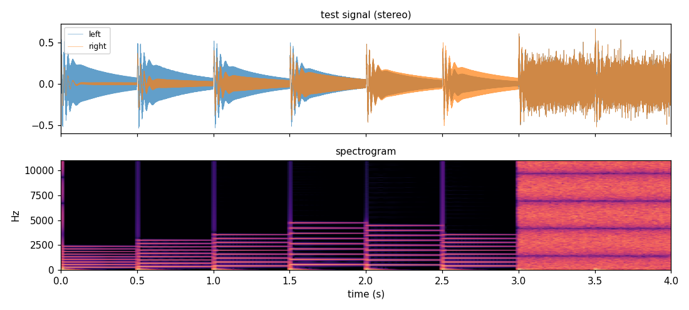
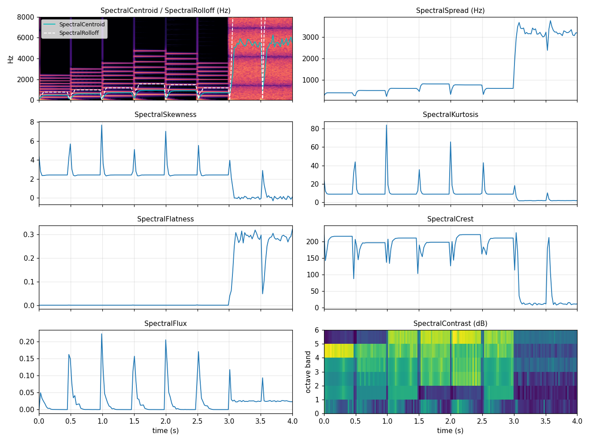
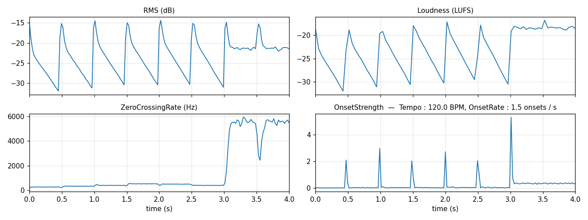
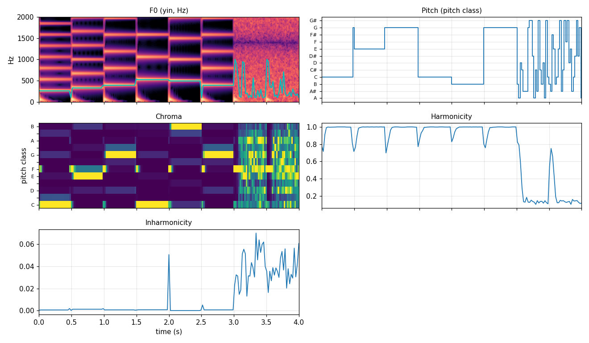
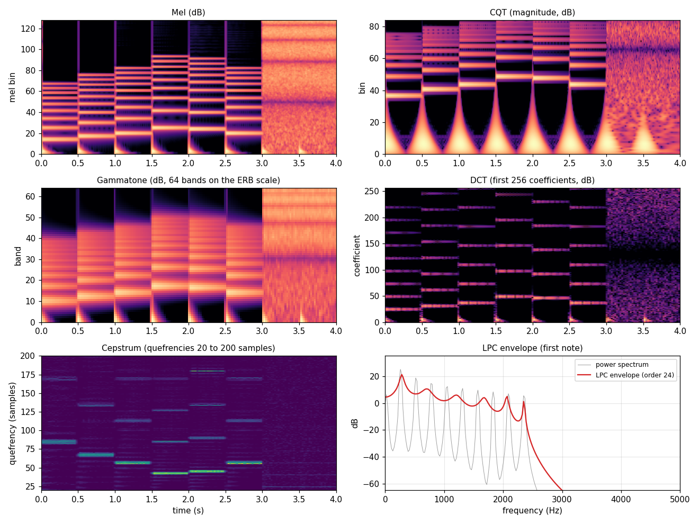
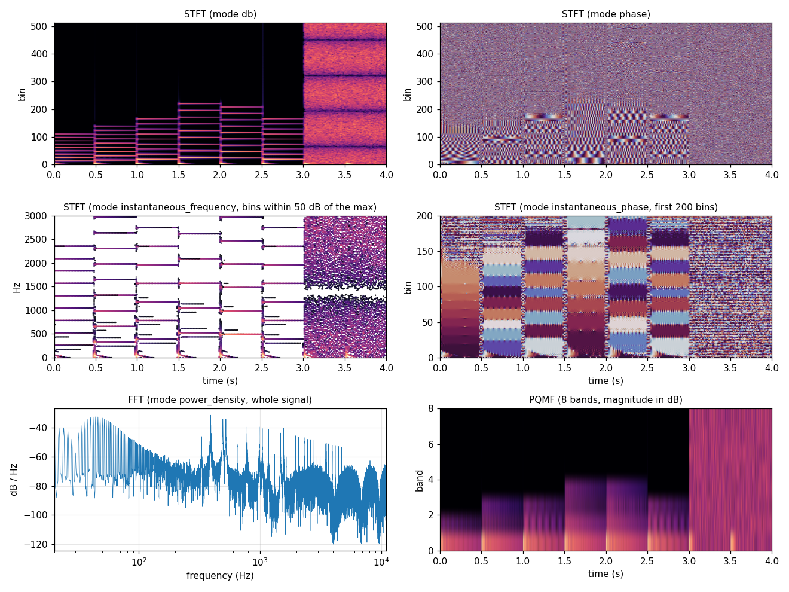
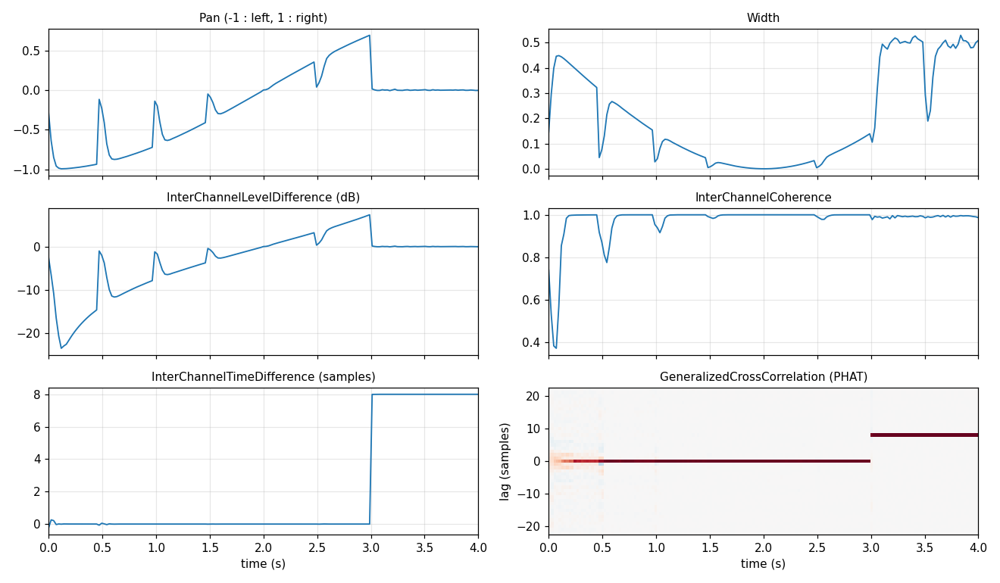

# 3. Features

Features are computed on each item, and given in outputs with the `output_pattern` of the dataset. In online datasets, they are computed on the fly, or read from features computed once on whole files (see [Baked features](../guide/datasets.md#baked-features)).

```python
from acids_dataset.datasets import AudioDataset
from acids_dataset.features import Loudness, SpectralCentroid, Tempo

dataset = AudioDataset("tutorial_dataset", sr=22050, chunk_length=1.,
                       features=[Loudness(sr=22050), SpectralCentroid(sr=22050)],
                       output_pattern="{waveform,loudness,spectral_centroid}")
item = dataset[0]
print({k: tuple(v.shape) for k, v in item.items()})
```

Each feature has a name (`loudness`, `spectral_centroid`...), used in output patterns. Names can be chosen by giving features as a dict :

```python
dataset = AudioDataset("tutorial_dataset", sr=22050, chunk_length=1.,
                       features={"brightness": SpectralCentroid(sr=22050, unit="normalized")},
                       output_pattern="(waveform,brightness)")
waveform, brightness = dataset[0]
print(float(brightness.mean()))
```

Many descriptors are available : loudness, pitch (`F0`, `Pitch`), spectral shape, onsets and tempo, chroma, spatial descriptors, quality descriptors, neural embeddings... See the [catalog](../guide/features.md).

## Metadata from file names

`meta_regexp` patterns extract metadata from file paths, with placeholders in double braces :

```python
dataset = AudioDataset("tutorial_dataset", sr=22050, chunk_length=1., meta_regexp=["**/{{instrument}}_*.wav"])
print(dataset.files[0]["metadata"])
print({value: len(files) for value, files in dataset.feature_hash["instrument"].items()})
```

Metadata can be used to search items, to build [partitions](05-partitions.md), and to [balance classes](07-training.md) :

```python
drums = dataset.query_from_features(4, instrument="drums")   # 4 random chunks of drums files
print(len(drums[("drums",)]))
```

## Fragments

`get_fragment` loads a chunk of a file with its metadata and features :

```python
dataset = AudioDataset("tutorial_dataset", sr=22050, chunk_length=1., features=[Tempo(sr=22050)])
fragment = dataset.get_fragment(len(dataset.files) - 1, start=0., length=3.)   # last file (a drums file), 3 seconds
print(fragment.get_metadata()["audio_path"], float(fragment.get("tempo")))
```

## Summary of available features

All features are in `acids_dataset.features`. The name is the default key in output patterns (it can be changed by giving features as a dict). Per-frame features end with a `n_frames` axis ; per-chunk features give one value per chunk. Details on each descriptor are in the [catalog](../guide/features.md).

| Family | Feature | Name | Output |
| ------ | ------- | ---- | ------ |
| loudness & energy | `Loudness` | `loudness` | per frame (or per chunk), LUFS |
| | `RMS` | `rms` | per frame, dB |
| pitch | `F0` | `f0` | per frame, Hz (`mode` : `yin`, `pyin`, and `crepe`, `pesto`, `world`, `praat` if installed) |
| | `Pitch` | `pitch` | per frame, pitch class (0 : A ... 11 : G#) |
| spectral | `SpectralCentroid`, `SpectralSpread`, `SpectralRolloff` | `spectral_centroid`, ... | per frame, Hz / normalized / midi |
| | `SpectralSkewness`, `SpectralKurtosis`, `SpectralFlatness`, `SpectralCrest`, `SpectralFlux` | `spectral_skewness`, ... | per frame |
| | `SpectralContrast` | `spectral_contrast` | `(n_bands, n_frames)`, dB |
| representations | `Mel` | `mel_<n_mels>` | `(n_mels, n_frames)` mel spectrogram |
| | `CQT` | `cqt_<n_bins>` | `(2 C, n_bins, n_frames)` constant-Q transform (real and imaginary parts) |
| | `STFT` | `stft`, `stft_<modes>` | `(K, n_frames)` short-time Fourier transform (complex, magnitude, power, dB, phase, real, imaginary, power density, instantaneous phase or frequency ; several modes are stacked) |
| | `FFT` | `fft`, `fft_<modes>` | `(K,)` Fourier transform of the whole chunk (same modes, one-sided or full) |
| | `PQMF` | `pqmf_<n_bands>` | `(C * n_bands, T / n_bands)` sub-bands of a pseudo-QMF filter bank |
| | `Gammatone` | `gammatone_<n_bands>` | `(n_bands, n_frames)` gammatone spectrogram (ERB scale) |
| | `DCT` | `dct` | `(n_coeffs, n_frames)` discrete cosine transform of frames |
| | `Cepstrum` | `cepstrum` | `(n_coeffs, n_frames)` real cepstrum |
| | `LPC` | `lpc`, `lpc_<mode>` | `(order, n_frames)` LPC coefficients, reflection coefficients or line spectral frequencies ; `(n_bins, n_frames)` envelope |
| temporal | `ZeroCrossingRate` | `zero_crossing_rate` | per frame, ratio or Hz |
| | `AttackTime`, `TemporalCentroid` | `attack_time`, `temporal_centroid` | per chunk, seconds |
| | `CrestFactor` | `crest_factor` | per chunk, dB |
| onsets & rhythm | `OnsetStrength` | `onset_strength` | per frame |
| | `OnsetRate` | `onset_rate` | per chunk, onsets / s |
| | `Tempo` | `tempo` | per chunk, BPM |
| | `BeatTrack` | `beat_<downsample>` | beat phase, with the [Beat This!](https://github.com/CPJKU/beat_this) model |
| harmonic | `Chroma` | `chroma` | `(12, n_frames)` |
| | `Harmonicity`, `Inharmonicity` | `harmonicity`, `inharmonicity` | per frame |
| spatial | `Pan` | `pan` | per frame, [-1, 1] |
| | `Width` | `width` | per frame (width, ratio or energies) |
| | `InterChannelLevelDifference`, `InterChannelTimeDifference`, `InterChannelCoherence` | `ild`, `itd`, `coherence` | `(C - 1, n_frames)` |
| | `GeneralizedCrossCorrelation` | `gcc` | `(P, n_frames)` delays, or `(P, n_lags, n_frames)` |
| | `SpatialCovariance` | `spatial_covariance` | `(C, C, n_frames)` |
| | `CrossSpectralMatrix` | `csm` | `(2, K, C, C, n_frames)` |
| | `SpectroSpatialCovarianceVector` | `sscv` | `(C^2, n_bands, n_frames)` |
| quality | `ClippingRatio`, `DCOffset`, `DynamicRange`, `SilenceRatio` | `clipping_ratio`, `dc_offset`, ... | per chunk |
| symbolic | `AfterMIDI` | `midi` | MIDI notes of the chunk, from MIDI files found next to audio files, or transcribed with BasicPitch |
| models | `ModuleEmbedding` | `embedding` | output of a PyTorch / TorchScript model |
| metadata | `RegexpFeature` | from the pattern | metadata from file paths (`meta_regexp`) |

## Gallery

The figures below show the features on a synthetic stereo signal of 4 seconds (22050 Hz) : a melody (C4 E4 G4 C5 B4 G4) panned from left to right, kicks at 120 BPM, and a noise burst in the last second, delayed by 8 samples in the right channel. Frames are 1024 samples long, with a hop of 512 samples.



**Spectral descriptors.** Centroid, rolloff and spread follow the brightness of the notes, and jump with the noise. Flatness separates tones (≈ 0) from noise (≈ 0.56), while skewness, kurtosis and flux peak at note onsets.



**Energy, loudness and onsets.** RMS and loudness follow the decay of each note. Onset strength peaks at each kick, and `Tempo` finds the 120 BPM of the signal.



**Pitch and harmony.** `F0` follows the fundamental frequency, `Pitch` gives its pitch class, and `Chroma` the energy of each pitch class. Harmonicity is close to 1 for the notes and drops for the noise.



**Spectral representations.** `Mel`, `CQT` (magnitude of its real and imaginary parts) and `Gammatone` spectrograms, the `DCT` of frames, the `Cepstrum` (with a peak at the period of each note, `sr / f0`), and the `LPC` envelope (order 24) of the spectrum of the first note. Spectrograms are computed on the mix of channels : the stripes of the noise burst come from comb filtering, as the noise is delayed in one channel.



**Fourier transforms and filter banks.** `STFT` with several modes : dB and phase, then the instantaneous frequency of the loudest bins, which gives the exact frequency of each harmonic, and the instantaneous phase. `FFT` gives the power spectral density of the whole signal, and `PQMF` splits the signal into 8 sub-bands of 1378 Hz, sampled 8 times slower.



**Spatial descriptors.** `Pan` and the level difference follow the melody from left to right. Kicks and noise are centered, so their level difference is zero. The 8 samples delay of the noise is found by `InterChannelTimeDifference` and by the peak of `GeneralizedCrossCorrelation`. `Width` measures the stereo width : 0 at the center, where both channels have the same level, and ≈ 0.5 for the delayed noise.



Figures are generated by [`extras/features/make_docs_gallery.py`](https://github.com/acids-ircam/acids-dataset/blob/main/extras/features/make_docs_gallery.py). The [example notebooks](https://github.com/acids-ircam/acids-dataset/tree/main/extras/features) show features in more detail.

Next : [outputs and augmentations](04-outputs-augmentations.md).

!!! info "See also"
    [Features](../guide/features.md) in the documentation.
